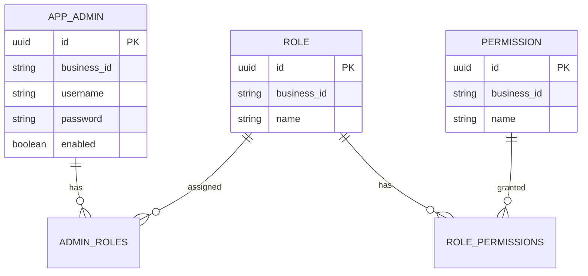

# Domain Model & Flow

## Entities

- **AppAdmin** (`app_admins`): admin user account. PK `UUID id`, unique `businessId`, `username`, `password`, `enabled`, and a many-to-many relation to `Role`.
- **Role** (`roles`): a named role. PK `UUID id`, unique `businessId`, `name`, and a many-to-many relation to `Permission`.
- **Permission** (`permissions`): a named permission (`resource:action`). PK `UUID id`, unique `businessId`, `name`.

## Relationships

- `AppAdmin` ↔ `Role`: many-to-many via `admin_roles` (admin_id, role_id).
- `Role` ↔ `Permission`: many-to-many via `role_permissions` (role_id, permission_id).

## ER Diagram



## Package Structure

```
com.boardwith.admin
├── config             # Security configuration (SecurityConfig, JwtService, JwtAuthenticationFilter)
├── controller         # REST controllers (AuthController, AdminController, DemoController, RolePermissionController)
├── domain.entity      # JPA entities (AppAdmin, Role, Permission)
├── dto.request        # Request DTOs (RegistrationRequest, LoginRequest, AdminRegistrationRequest)
├── dto.response       # Response DTOs (AuthResponse)
├── helper             # Utilities (BusinessIdGenerator, BusinessIdExistsChecker)
├── repository         # Spring Data JPA repositories (AppAdminRepository, RoleRepository, PermissionRepository)
└── service            # Business services (AppUserDetailsService, DataSeeder)
```

## Authentication (JWT)

Authentication is stateless and uses JWT (JSON Web Token) access tokens signed with HMAC-SHA256.

### Flow
1. A client registers via `POST /api/public/register` (no auth required).
2. An administrator assigns roles via `POST /api/admin/register-admin` (requires `ADMIN` or `SUPER_ADMIN`).
3. The client logs in via `POST /api/public/login` with `username` and `password` and receives a JWT access token.
4. The client sends the token on subsequent requests as `Authorization: Bearer <token>`.
5. `JwtAuthenticationFilter` validates the token and populates the Spring Security context.
6. Authorization is enforced by role (`hasRole`/`hasAnyRole`) via `SecurityConfig`.

### Endpoints
| Method | Endpoint | Auth required | Description |
|--------|----------|---------------|-------------|
| `POST` | `/api/public/register` | No | Create a new account (no roles assigned) |
| `POST` | `/api/public/login` | No | Authenticate and receive a JWT access token |
| `POST` | `/api/admin/register-admin` | `ADMIN`/`SUPER_ADMIN` | Register an admin and assign roles |
| `GET` | `/api/admin/dashboard` | `ADMIN`/`SUPER_ADMIN` | Admin dashboard |
| `GET` | `/api/user/me` | `ADMIN`/`SUPER_ADMIN` | Current user profile |

### Response
```json
{
  "token": "eyJ..."
}
```

### Token
- Algorithm: HS256
- Expiration: 12 hours
- Header: `Authorization: Bearer <jwt>`
- Claims:
  - `sub` — username
  - `username` — username (explicit claim)
  - `roles` — list of assigned role names (e.g. `["ADMIN", "SUPER_ADMIN"]`)
  - `permissions` — list of permission strings from all assigned roles (e.g. `["admin_users:read", "users:read"]`)
  - `iat` — issued-at timestamp
  - `exp` — expiration timestamp

The JWT token itself contains the `username`, `roles`, and `permissions` as claims — decode the token to access them. They are **not** returned as separate fields in the response body.

## Flow

1. On startup, `DataSeeder` (`com.boardwith.admin.service`) seeds permissions, roles (with mapped permissions), and `admin`/`superadmin` accounts.
2. Registration (`AuthController`) creates an `AppAdmin` without any role; an administrator must assign roles explicitly.
3. Authentication (`AppUserDetailsService` in `com.boardwith.admin.service`) loads the `AppAdmin`, collects roles and permissions from all assigned roles, and builds Spring Security `UserDetails`.
4. Authorization is enforced in `SecurityConfig` by role (`hasRole`/`hasAnyRole`) and permission checks can be added via method security.
